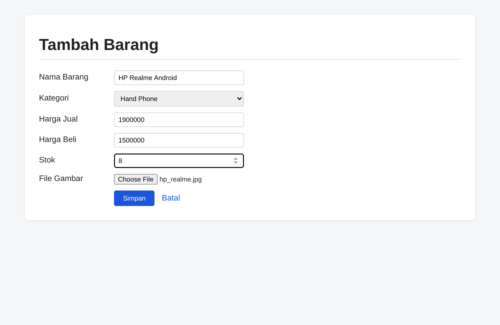
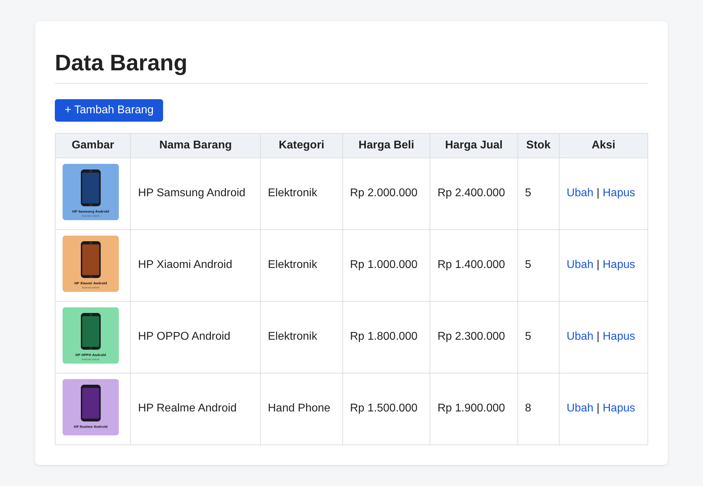
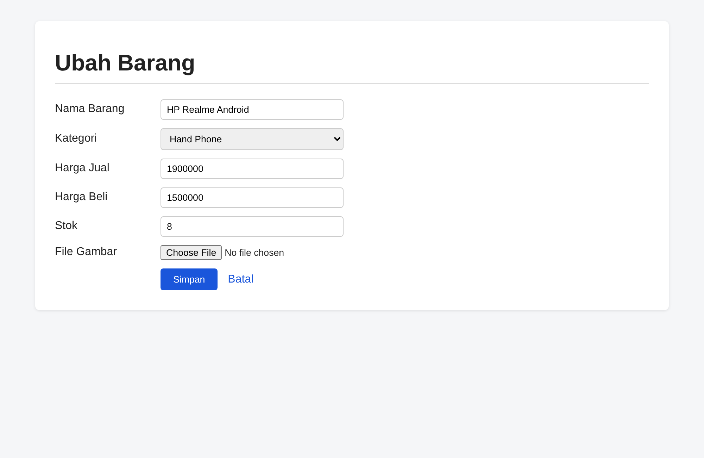
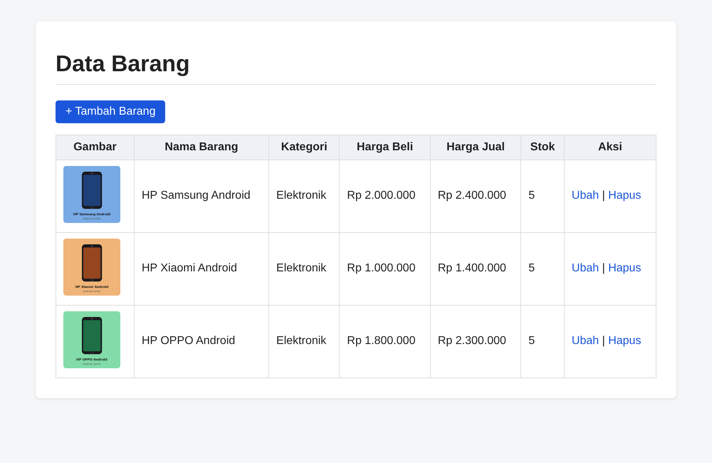

# Praktikum 8: PHP dan Database MySQL

**Nama:** Muhamad Prasetyo Andri Wibowo
**NIM:** 312510181
**Kelas:** I251B
**Program Studi:** Teknik Informatika, Universitas Pelita Bangsa
**Mata Kuliah:** Pemrograman Web

---

## Tujuan Praktikum

1. Memahami konsep dasar database.
2. Memahami konsep dasar CRUD (Create, Read, Update, Delete) menggunakan PHP.
3. Membuat program CRUD sederhana menggunakan PHP dan MySQL.

Di praktikum ini saya membuat aplikasi sederhana untuk mengelola **Data Barang**. Datanya disimpan di MySQL, lalu PHP dipakai untuk menampilkan, menambah, mengubah, dan menghapus data tersebut lewat browser.

## Struktur Folder

```
lab8_php_database/
├── database.sql    -> perintah SQL untuk membuat database, tabel, dan data awal
├── koneksi.php     -> koneksi PHP ke MySQL
├── index.php       -> menampilkan data (Read)
├── tambah.php      -> menambah data (Create)
├── ubah.php        -> mengubah data (Update)
├── hapus.php       -> menghapus data (Delete)
├── style.css       -> tampilan
└── gambar/         -> tempat menyimpan gambar barang yang diupload
```

Folder ini saya taruh di `htdocs` XAMPP, jadi bisa dibuka lewat `http://localhost/lab8_php_database/`.

---

## Langkah 1: Menjalankan MySQL Server

Sebelum membuat apa pun, database server harus hidup dulu. Saya buka **XAMPP Control Panel**, lalu klik **Start** pada modul **Apache** (web server) dan **MySQL** (database server). Kalau keduanya sudah berwarna hijau dan muncul nomor port (80 untuk Apache dan 3306 untuk MySQL), berarti siap dipakai.

Apache saya butuhkan untuk menjalankan file PHP di browser, sedangkan MySQL untuk menyimpan datanya. Jadi dua-duanya harus menyala.


## Langkah 2: Membuka phpMyAdmin

Setelah Apache dan MySQL jalan, saya buka `http://localhost/phpmyadmin/` di browser. phpMyAdmin ini semacam "layar kontrol" untuk MySQL, jadi saya bisa membuat database dan tabel tanpa harus mengetik lewat terminal.


## Langkah 3: Membuat Database dan Tabel

Studi kasus yang dipakai adalah data barang. Rancangan tabelnya seperti ini:

| Nama Field | Tipe Data | Ukuran | Keterangan |
|---|---|---|---|
| id_barang | INT | 10 | Primary Key, Auto Increment |
| kategori | VARCHAR | 30 | |
| nama | VARCHAR | 50 | |
| gambar | VARCHAR | 100 | |
| harga_beli | DECIMAL | 10 | |
| harga_jual | DECIMAL | 10 | |
| stok | INT | 4 | |

Di tab **SQL** phpMyAdmin saya jalankan:

```sql
CREATE DATABASE latihan1;
```

Lalu saya pilih database `latihan1` dan membuat tabelnya:

```sql
CREATE TABLE data_barang (
  id_barang  INT(10) AUTO_INCREMENT PRIMARY KEY,
  kategori   VARCHAR(30),
  nama       VARCHAR(50),
  gambar     VARCHAR(100),
  harga_beli DECIMAL(10,0),
  harga_jual DECIMAL(10,0),
  stok       INT(4)
);
```

`id_barang` saya jadikan Primary Key dengan `AUTO_INCREMENT`, jadi nomornya otomatis naik tiap ada barang baru dan tidak perlu saya isi sendiri. Kolom `gambar` hanya menyimpan **alamat/nama file** gambarnya, bukan gambarnya langsung. File gambarnya sendiri disimpan di folder `gambar/`.

> Catatan: di modul, ukuran kolom `nama` di tabel rancangan adalah 50, tetapi di contoh SQL tertulis 30. Saya ikut rancangan tabel (50) supaya nama barang yang agak panjang tidak terpotong.


## Langkah 4: Menambahkan Data Awal

Supaya halaman daftar barang tidak kosong, saya isi tiga data contoh:

```sql
INSERT INTO data_barang (kategori, nama, gambar, harga_beli, harga_jual, stok) VALUES
('Elektronik', 'HP Samsung Android', 'gambar/hp_samsung.jpg', 2000000, 2400000, 5),
('Elektronik', 'HP Xiaomi Android',  'gambar/hp_xiaomi.jpg',  1000000, 1400000, 5),
('Elektronik', 'HP OPPO Android',    'gambar/hp_oppo.jpg',    1800000, 2300000, 5);
```

Saya sengaja menulis `gambar/hp_samsung.jpg` (lengkap dengan nama foldernya), supaya sama persis dengan format yang nanti dihasilkan oleh form tambah barang. Setelah itu saya cek dengan `SELECT * FROM data_barang;` dan tiga baris tadi muncul.


## Langkah 5: Membuat Folder Proyek

Saya buat folder `lab8_php_database` di dalam `htdocs` (misalnya `C:\xampp\htdocs\lab8_php_database`), lalu di dalamnya saya buat folder `gambar`. Saat dibuka di `http://localhost/lab8_php_database/`, awalnya yang tampil hanya daftar file kosong karena belum ada kode PHP-nya.


## Langkah 6: File Koneksi Database (`koneksi.php`)

```php
<?php
$host = "localhost";
$user = "root";
$pass = "";
$db   = "latihan1";

$conn = mysqli_connect($host, $user, $pass, $db);

if (!$conn) {
    die("Koneksi ke server gagal: " . mysqli_connect_error());
}
```

Penjelasan yang saya pahami:

- Empat variabel pertama berisi data untuk masuk ke MySQL: alamat server (`localhost`), username (`root`), password (kosong, karena bawaan XAMPP memang tanpa password), dan nama database (`latihan1`).
- `mysqli_connect()` mencoba menyambungkan PHP ke database memakai data tadi. Hasilnya disimpan di `$conn`.
- Kalau gagal, `die()` menghentikan program dan menampilkan pesan error, jadi halaman lain tidak lanjut berjalan dalam keadaan rusak.
- File ini tidak punya tampilan sendiri. Fungsinya hanya untuk dipanggil (`include`) oleh file lain, jadi koneksinya cukup ditulis sekali.

Untuk mengetes koneksi, saya hapus tanda `//` di depan `echo "Koneksi berhasil";`, lalu buka `koneksi.php` di browser. Setelah muncul tulisan "Koneksi berhasil", tanda komentarnya saya pasang lagi.


## Langkah 7: Menampilkan Data / Read (`index.php`)

Bagian PHP di atas file:

```php
<?php
include("koneksi.php");
$sql = "SELECT * FROM data_barang ORDER BY id_barang ASC";
$result = mysqli_query($conn, $sql);
?>
```

- `include("koneksi.php")` memanggil koneksi yang tadi dibuat.
- `SELECT * FROM data_barang` artinya "ambil semua kolom dari semua baris di tabel data_barang".
- `mysqli_query()` mengirim perintah itu ke MySQL, dan hasilnya disimpan di `$result`.

Di bagian HTML, data ditampilkan dengan perulangan:

```php
<?php while ($row = mysqli_fetch_assoc($result)): ?>
<tr>
    <td> ...gambar... </td>
    <td><?= htmlspecialchars($row['nama']); ?></td>
    ...
</tr>
<?php endwhile; ?>
```

`mysqli_fetch_assoc()` mengambil satu baris hasil query dalam bentuk array, misalnya `$row['nama']`. Perulangan `while` terus mengambil baris berikutnya sampai habis, dan setiap baris menjadi satu `<tr>` di tabel. Kalau tabel kosong, tampil tulisan "Belum ada data".

Beberapa hal yang saya tambahkan supaya hasilnya lebih rapi:

- `htmlspecialchars()` membungkus semua teks dari database supaya kalau ada karakter seperti `<` atau `>` tidak dibaca sebagai kode HTML.
- `number_format()` membuat harga tampil seperti `Rp 2.400.000`.
- Gambar hanya ditampilkan kalau filenya benar-benar ada (`file_exists`). Kalau tidak ada, tampil tulisan "Belum ada gambar", jadi tidak muncul ikon gambar rusak.
- Kolom **Aksi** berisi link **Ubah** dan **Hapus** yang membawa `id` barang, misalnya `ubah.php?id=2`. Link Hapus diberi konfirmasi `confirm()` supaya tidak terhapus karena salah klik.


## Langkah 8: Menambah Data / Create (`tambah.php`)

Halaman ini punya dua bagian: **form** (HTML) dan **proses simpan** (PHP) yang jalan ketika tombol Simpan ditekan.

Form-nya memakai `method="post"` dan `enctype="multipart/form-data"`. Atribut `enctype` ini wajib kalau form mengirim file, kalau tidak, gambar tidak akan terkirim.

Alur proses simpan:

1. `isset($_POST['submit'])` mengecek apakah tombol Simpan sudah ditekan.
2. Data form diambil dari `$_POST`. Angka diubah dengan `(int)` supaya yang masuk benar-benar angka.
3. Kalau ada file gambar (`$_FILES['file_gambar']['error'] == 0`), saya cek dulu ekstensinya (hanya jpg, jpeg, png, gif, webp). Nama filenya diberi awalan `time()` supaya tidak bentrok kalau ada dua file bernama sama, lalu dipindahkan ke folder `gambar/` dengan `move_uploaded_file()`.
4. Data dimasukkan ke database dengan **prepared statement**:

```php
$stmt = mysqli_prepare($conn,
    "INSERT INTO data_barang (nama, kategori, harga_jual, harga_beli, stok, gambar)
     VALUES (?, ?, ?, ?, ?, ?)");
mysqli_stmt_bind_param($stmt, "ssiiis", $nama, $kategori, $harga_jual, $harga_beli, $stok, $gambar);
mysqli_stmt_execute($stmt);
```

Tanda `?` adalah tempat kosong yang diisi belakangan lewat `bind_param`. Huruf `ssiiis` menunjukkan tipe tiap data: `s` untuk string dan `i` untuk integer. Dengan cara ini input pengguna tidak ikut dibaca sebagai perintah SQL, sehingga aman dari **SQL Injection**.

5. Setelah tersimpan, `header('Location: index.php')` mengarahkan pengguna kembali ke daftar barang.



Setelah Simpan ditekan, halaman kembali ke daftar barang dan data baru (HP Realme Android) sudah muncul lengkap dengan gambarnya.



## Langkah 9: Mengubah Data / Update (`ubah.php`)

Halaman ini mirip dengan tambah, bedanya form-nya sudah terisi data lama.

**Bagian menampilkan data lama.** Saat link Ubah diklik, `id` dibawa lewat URL (`ubah.php?id=2`) dan diambil dengan `$_GET['id']`. Dengan id itu saya `SELECT` satu barang, lalu nilainya dimasukkan ke atribut `value` pada setiap input. Satu input tersembunyi (`type="hidden"`) menyimpan id supaya ikut terkirim saat disimpan.

**Bagian menyimpan perubahan.** Perintahnya `UPDATE ... WHERE id_barang = ?`. Bagian `WHERE` ini penting, karena tanpa itu semua baris di tabel akan ikut berubah. Kalau pengguna tidak memilih gambar baru, kolom `gambar` tidak disentuh, jadi gambar lama tetap aman. Kalau memilih gambar baru, kolom gambar ikut diperbarui.

**Dropdown kategori.** Fungsi kecil `is_select()` membandingkan kategori barang dengan tiap pilihan, lalu menambahkan `selected="selected"` pada yang cocok, jadi kategori yang tampil sesuai data lama.



Saya coba ubah harga jual menjadi 1.950.000 dan stok menjadi 12. Hasilnya langsung terlihat di daftar barang.


## Langkah 10: Menghapus Data / Delete (`hapus.php`)

```php
<?php
include_once 'koneksi.php';
$id = (int)($_GET['id'] ?? 0);

$stmt = mysqli_prepare($conn, "DELETE FROM data_barang WHERE id_barang = ?");
mysqli_stmt_bind_param($stmt, "i", $id);
mysqli_stmt_execute($stmt);

header('Location: index.php');
exit;
```

Id barang diambil dari URL, lalu baris dengan id itu dihapus. File ini juga tidak punya tampilan, jadi begitu selesai langsung dikembalikan ke `index.php`. Sebelum sampai ke sini, pengguna sudah melewati kotak konfirmasi di halaman index.

Setelah tombol Hapus ditekan dan dikonfirmasi, data HP Realme Android hilang dari daftar dan tersisa tiga data awal.



---

## Catatan Perbaikan dari Kode di Modul

Waktu mengetik ulang dan mencoba kode di modul, saya menemukan beberapa hal yang perlu diperbaiki supaya aplikasinya benar-benar jalan:

1. **Tabel di `index.php`:** pada modul, header "Harga Jual" dan "Harga Beli" urutannya terbalik dibanding isi barisnya, kolom Aksi hanya menampilkan angka id (bukan link Ubah/Hapus), dan link "Tambah Barang" tidak ada. Semuanya saya perbaiki.
2. **Dropdown di `ubah.php`:** ketiga pilihan sama-sama dibandingkan dengan `'Komputer'`, sehingga kategori lain tidak pernah terpilih. Saya sesuaikan masing-masing.
3. **`enctype`:** di modul tertulis `multipart/formdata` (terpotong karena pindah baris). Yang benar `multipart/form-data`.
4. **Keamanan:** query di modul menyisipkan input langsung ke SQL sehingga rawan SQL Injection. Saya ganti dengan prepared statement.
5. **Tanda `;;`** yang berlebihan di `$gambar = 'gambar/' . $filename;;` saya rapikan.

## Cara Menjalankan

1. Jalankan Apache dan MySQL di XAMPP.
2. Buka phpMyAdmin, lalu import file `database.sql` (atau jalankan isinya di tab SQL).
3. Salin folder proyek ke `htdocs` dengan nama `lab8_php_database`.
4. Buka `http://localhost/lab8_php_database/`.